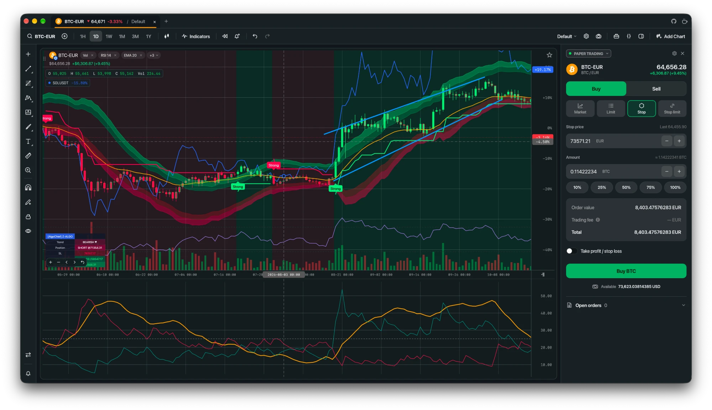

  

# DegenView

A free, open source TradingView alternative for your desktop. Multi-chart layouts for crypto, stocks and prediction markets, a local Pine Script v6 engine, alerts, bar replay, paper trading and portfolio tracking, plus an optional MCP server for AI assistants. No account needed, and it runs on your machine.

[**Website**](https://degenview.app) · [**Download**](https://degenview.app/download/) · [**Docs**](https://docs.degenview.app) · [**Source**](https://github.com/degenview/degenview)

Available for macOS, Windows and Linux (Homebrew and Flatpak included). Licensed GPL-3.0-only.

DegenView is an independent project and is not affiliated with TradingView.
